Open Wallpaper Engine
=========

[English](../../README.md) | [Deutsch](README.de.md) | [Français](README.fr.md) | [Español](README.es.md) | **Português (Brasil)** | [Italiano](README.it.md) | [日本語](README.ja.md) | [한국어](README.ko.md) | [简体中文](README.zh-Hans.md) | [繁體中文](README.zh-Hant.md) | [Русский](README.ru.md) | [Polski](README.pl.md) | [Türkçe](README.tr.md) | [Українська](README.uk.md) | [العربية](README.ar.md) | [हिन्दी](README.hi.md)

 

O Open Wallpaper Engine é um app gratuito e de código aberto para macOS que reproduz e edita imagens de fundo do Wallpaper Engine: cena, vídeo e web. As cenas são desenhadas por um renderizador nativo em Metal, com efeitos, partículas, modelos 3D, iluminação, SceneScript e visuais reativos ao áudio, e a Oficina Steam vem integrada. Começou como um fork do [Open Wallpaper Engine](https://github.com/MrWindDog) de Haren Chen e MrWindDog e, desde então, foi em grande parte reescrito.

> **Observação:** este projeto NÃO tem nenhuma relação com o Wallpaper Engine comercial vendido no Steam. É um app de código aberto para macOS capaz de exibir os recursos de imagens de fundo da Oficina Steam do Wallpaper Engine. → [ATTRIBUTION.txt](../../ATTRIBUTION.txt)

**Site:** [openwallpaperengine.app](https://openwallpaperengine.app/) · **Wiki:** [guias e solução de problemas](https://github.com/deepratna-awale/open-wallpaper-engine-mac/wiki)

<!-- demo: desktop -->

<a href="../../docs/media/demo/hero.webm">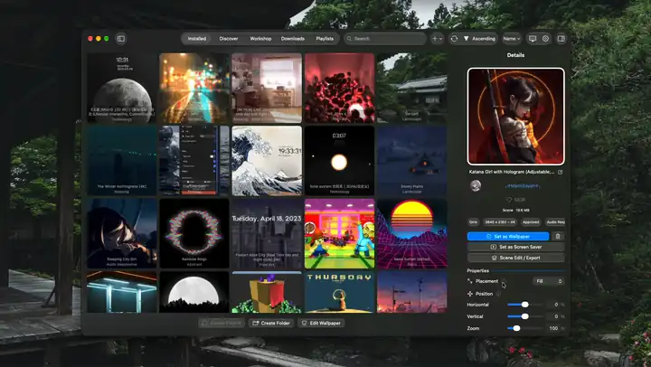</a>

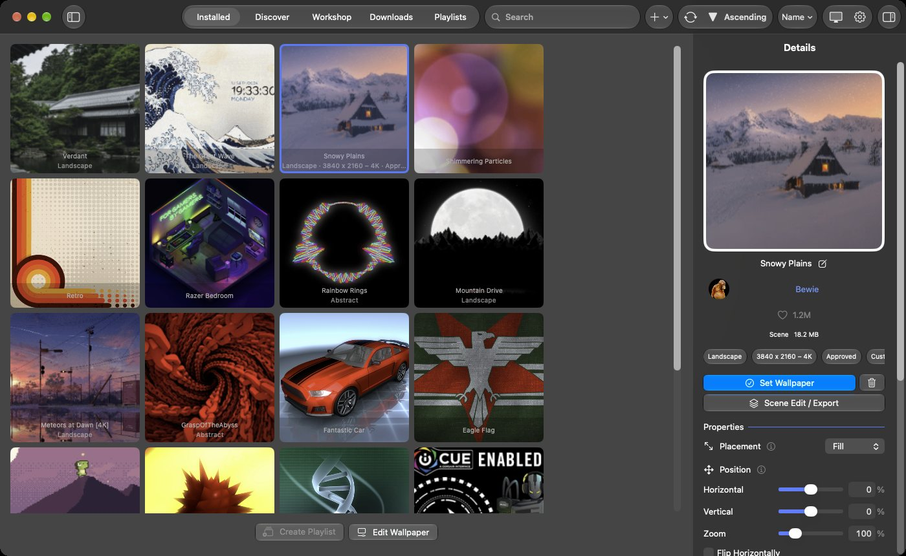

## O que o diferencia

- **O único app para macOS que edita cenas do Wallpaper Engine.** O Editor de Imagem de Fundo abre as camadas, os efeitos, as partículas, a linha do tempo e os scripts de uma cena e a salva como imagem de fundo do Wallpaper Engine.
- **Exportação para Live Photo e para o Wallpaper Engine no Android.** Qualquer cena ou vídeo vira uma tela bloqueada animada para iPhone e iPad, ou um pacote para o app Android do Wallpaper Engine.
- **Os próprios shaders do Wallpaper Engine, traduzidos.** Cada camada, efeito e material é desenhado com os shaders originais da imagem de fundo, traduzidos para Metal, incluindo os efeitos que os autores da Oficina escreveram eles mesmos.
- **Um protetor de tela totalmente ao vivo.** O protetor de tela desenha a imagem de fundo de cada tela enquanto ela é executada, então relógios, scripts e partes reativas ao áudio continuam se movendo. Nada é gravado.

## Destaques

- **Imagens de fundo de cena, vídeo e web**: cenas com efeitos, partículas, modelos 3D, luzes, linhas do tempo, SceneScript e visuais reativos ao áudio, e saída HDR para cenas e vídeos HDR10 ou HLG nas telas capazes de exibi-la. As imagens de fundo web rodam no WebKit ou no mecanismo Chromium opcional, com as propriedades da pasta, áudio ao vivo e Tocando Agora.
- **Oficina Steam**: navegue com as ordenações e os filtros do Wallpaper Engine, baixe com a sua própria conta Steam (inicie sessão com o código QR do app Steam Mobile ou com a senha), ou importe pastas e arquivos zip de imagens de fundo. A aba Instaladas tem as pastas e as ordenações do Wallpaper Engine. O SteamCMD e a chave da API Web da Steam estão obsoletos e não são mais usados: desde a 1.0.0-beta.13, o login com o app móvel da Steam substitui os dois.
- **Editor de Imagem de Fundo**: um editor no estilo do Wallpaper Engine. Adicione e organize camadas com gizmos, adicione efeitos com pré-visualização, escreva e edite seus próprios efeitos no Editor de shaders, importe modelos FBX e OBJ, anime em uma linha do tempo, escreva SceneScript, crie propriedades do usuário, edite sistemas de partículas e rigs de Puppet Warp, e use as ferramentas de imagem do Wallpaper Engine (Separação do plano frontal, Criação de ficha de personagem, Geração de mapa normal). **Nova Imagem de Fundo…** cria uma a partir de uma imagem ou de um dos modelos do Wallpaper Engine. Você edita um rascunho: **Salvar** aplica o rascunho, **Salvar como Nova Imagem de Fundo** adiciona uma cópia à biblioteca, e os arquivos da própria imagem de fundo nunca são alterados.

  <!-- demo: wallpaper-editor -->

  <a href="../../docs/media/demo/wallpaper-editor.webm">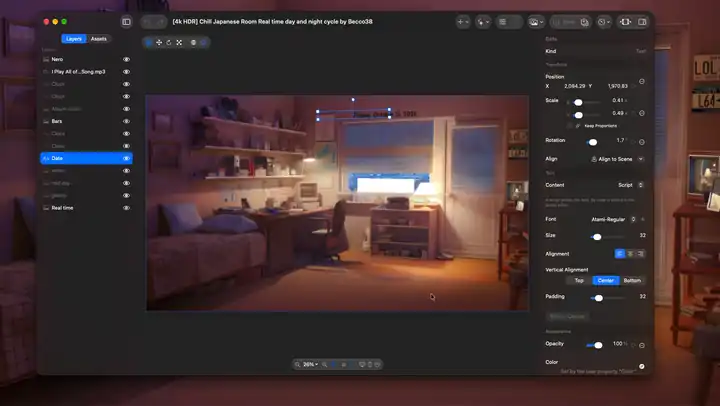</a>

  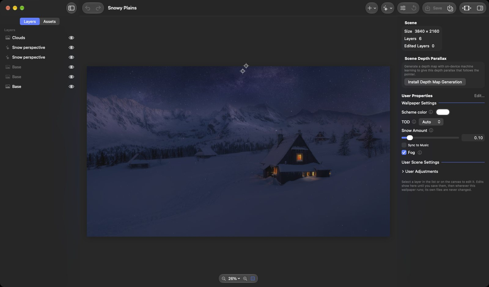

  <!-- demo: model-import -->

  <!-- demo: shader-editor -->

- **Editar/Exportar Cena**: altere ao vivo, na mesa, as camadas e os efeitos da imagem de fundo em execução, escolha o que o protetor de tela mostra, ou exporte a imagem de fundo como Live Photo ou como pacote Android.

  <a href="../../docs/media/demo/scene-edit.webm">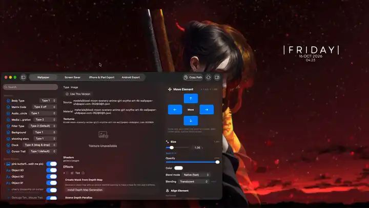</a>

  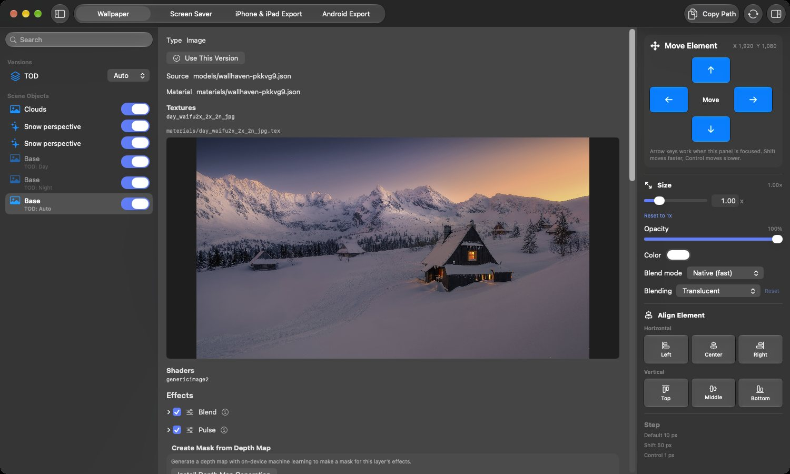

- **Protetor de tela e tela bloqueada**: o protetor de tela mostra ao vivo a imagem de fundo de cada tela (*Protetor de Tela Igual ao Papel de Parede*), ou uma que você escolher, e a tela bloqueada mostra uma imagem dela.

  <!-- demo: screen-saver -->

- **Exportação**: telas bloqueadas Live Photo para iPhone e iPad, enviadas por AirDrop ou salvas no Fotos, e pacotes Android do Wallpaper Engine, enviados ao dispositivo por Wi-Fi com um código QR.

  <!-- demo: live-photo-export -->

  <a href="../../docs/media/demo/live-photo-export.webm">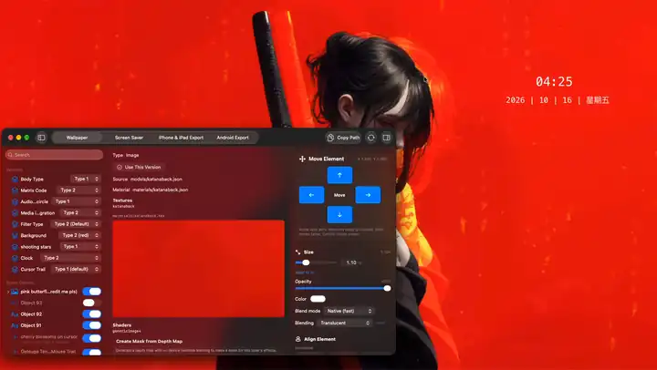</a>

  <!-- demo: android-export -->

  <a href="../../docs/media/demo/android-export.webm">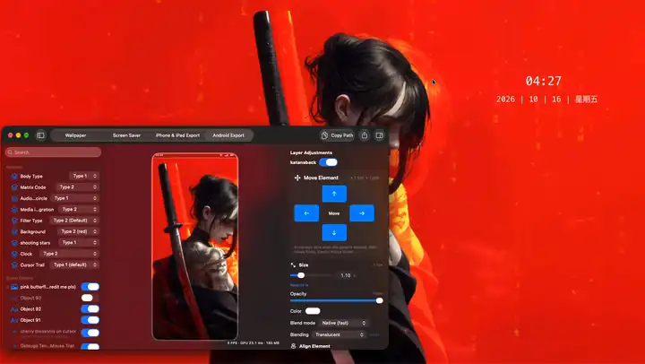</a>

  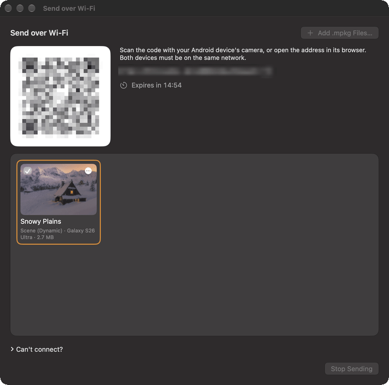

- **Telas**: uma imagem de fundo por tela, uma esticada em todas ou clonada em cada uma, grupos, divisões e perfis, como no Wallpaper Engine. **Reproduzir em Janela** reproduz uma imagem de fundo em uma janela própria.

  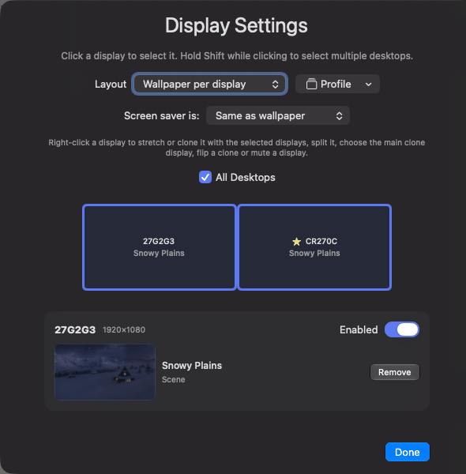

- **Playlists**: troque de imagem de fundo com um timer, no login, pela hora do dia ou pelo dia da semana, com as transições do Wallpaper Engine.

  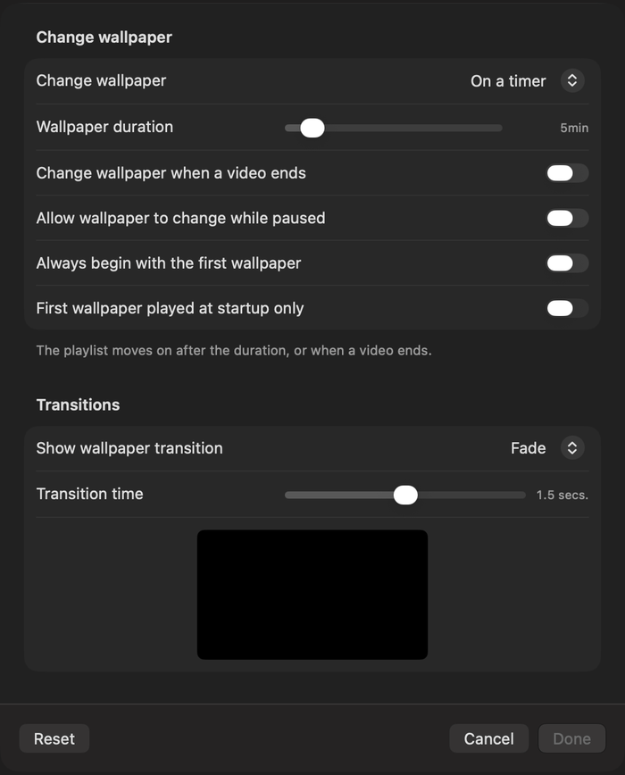

- **Controle**: atalhos para ações, playlists, imagens de fundo e perfis de tela; a [linha de comando](../../docs/command-line.md) `-control` do Wallpaper Engine; e o plug-in **Servidor MCP**, por meio do qual clientes MCP definem imagens de fundo, playlists e ajustes e editam cenas, por uma conexão local que só a sua conta pode abrir.

  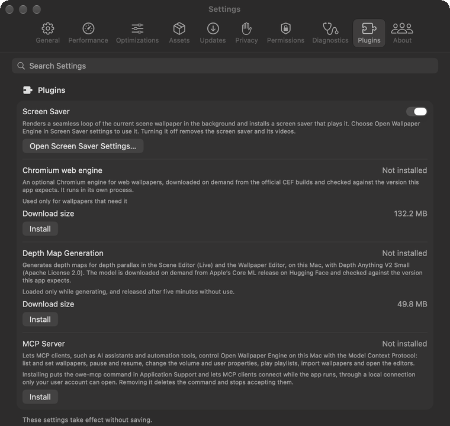

- **Energia**: as imagens de fundo pausam enquanto a tela está bloqueada, seguem a regra *Notebook na bateria* do Wallpaper Engine e podem passar para uma predefinição de qualidade e uma taxa de quadros menores na bateria ou no Modo de Baixa Energia.
- **Temas de Cor**: a barra de menus, a cor de destaque e os ícones e pastas tingidos acompanham a cor da imagem de fundo; as próprias janelas do Open Wallpaper Engine podem usar a cor exata.

  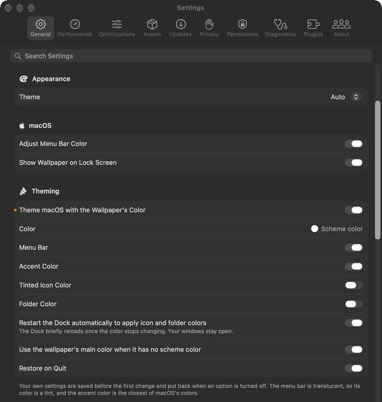

Todo o resto, área por área: [docs/features.md](../../docs/features.md).

## Instalação

1. Baixe a versão mais recente em [openwallpaperengine.app](https://openwallpaperengine.app/) ou no [GitHub Releases](https://github.com/deepratna-awale/open-wallpaper-engine-mac/releases). Ela é assinada e notarizada, e se atualiza sozinha.
2. Abra o DMG e arraste o **Open Wallpaper Engine** para Aplicativos.

Você precisa do **macOS 14.0 (Sonoma) ou posterior**. As imagens de fundo de cena precisam dos recursos do Wallpaper Engine da sua própria cópia do Wallpaper Engine no Steam; as imagens de fundo de vídeo e web, não. Alguns recursos exigem um macOS mais recente, uma permissão ou um plug-in: veja [Primeiros passos](../../docs/getting-started.md#requirements).

## Início rápido

1. Abra o app. O assistente de configuração define o idioma, seu login da Steam e os recursos do Wallpaper Engine, e pode importar seus favoritos e pastas do Wallpaper Engine; todas as etapas podem ser puladas.
2. Instale os recursos do Wallpaper Engine (*Ajustes › Recursos*) se quiser imagens de fundo de cena. Eles vêm da sua própria cópia do Wallpaper Engine no Steam; imagens de fundo de vídeo e web funcionam sem eles.
3. Encontre imagens de fundo nas abas **Descobrir** e **Oficina**, importe uma pasta ou um zip de imagem de fundo (*Arquivo › Importar Imagem de Fundo de Pasta…*, ⌘I) ou crie uma com **Adicionar Imagem de Fundo › Nova Imagem de Fundo…**.
4. Clique em uma imagem de fundo na biblioteca e depois em **Definir Imagem de Fundo** nos detalhes dela (ou clique nela com o botão direito e escolha **Definir como Imagem de Fundo**). As propriedades aparecem logo abaixo.

Mais: [Primeiros passos](../../docs/getting-started.md) e a [wiki](https://github.com/deepratna-awale/open-wallpaper-engine-mac/wiki).

## Privacidade

Tudo o que o app salva fica no seu Mac, e ele não coleta dados nem análises. Ele se comunica com a Steam (para a Oficina e os recursos), com o openwallpaperengine.app (para procurar atualizações) e com o GitHub (para baixá-las), e os plug-ins só são baixados quando você os instala. Detalhes: [com o que o app se conecta](../../docs/getting-started.md#what-the-app-connects-to) e a [Política de Privacidade](../../docs/legal/privacy-policy.md).

## Documentação

- [Primeiros passos](../../docs/getting-started.md) — requisitos, recursos, a Oficina e importação
- [Recursos](../../docs/features.md) — tudo o que o app suporta e como usar
- Guias: [layouts de tela](../../docs/display-layouts.md) · [playlists](../../docs/playlists.md) · [protetor de tela](../../docs/screen-saver.md) · [exportação para iPhone e iPad](../../docs/iphone-ipad-export.md) · [exportação para Android](../../docs/android-export.md) · [mapas de profundidade](../../docs/depth-maps.md) · [temas](../../docs/theming.md) · [importação de modelos](../../docs/model-import.md) · [ferramentas de imagem](../../docs/image-tools.md) · [Servidor MCP](../../docs/mcp.md) · [linha de comando](../../docs/command-line.md) · [mecanismo web Chromium](../../docs/chromium-engine.md)
- [Desenvolvimento](../../docs/development.md) — compilar a partir do código-fonte e a estrutura do projeto; [CONTRIBUTING.md](../../CONTRIBUTING.md) e [arquitetura](../../docs/architecture.md)
- [Wiki](https://github.com/deepratna-awale/open-wallpaper-engine-mac/wiki) — guias, referência de ajustes e solução de problemas

## Projetos Relacionados

- **[Open Wallpaper Engine for Linux](https://github.com/Unayung/simple-linux-wallpaperengine-gui)** — Uma interface gráfica em PyQt6 para o [linux-wallpaperengine](https://github.com/Almamu/linux-wallpaperengine), com integração à Oficina Steam e design de interface portado desta versão para macOS.

## Créditos

Este projeto foi construído sobre o trabalho de:

- **[MrWindDog](https://github.com/MrWindDog)** — Mantenedor do fork upstream [wallpaper-engine-mac](https://github.com/MrWindDog); adicionou novos recursos e refinamentos de interface
- **[Haren Chen](https://github.com/haren724)** — Criador original do [open-wallpaper-engine-mac](https://github.com/haren724/open-wallpaper-engine-mac); construiu a arquitetura central do app (SwiftUI, reprodução de imagens de fundo de vídeo, sistema de importação, interface de playlist)
- **1ris_W** — Tradução para o chinês
- **[Klaus Zhu](https://github.com/klauszhu1105)** — Design original do logotipo
- **[Chen Chia Yang](https://github.com/Unayung)** — Renderização de imagens de fundo de cena, correções para imagens de fundo web, integração à Oficina Steam, suporte a várias telas, importação de zip
- **[Deepratna Awale](https://github.com/deepratna-awale)** — Renderizador de cenas em Metal e pipeline de efeitos, tradução e cache de shaders GLSL→MSL, runtime do SceneScript, renderização sensível a áudio, reformulação da Oficina e dos Downloads, ajustes de posicionamento e de desempenho, redesenho do logotipo

Licenciado sob a [GPL-3.0](../../LICENSE), assim como o projeto original.

O auxiliar da Steam que o app executa como um programa separado ([`SteamHelper/`](../../SteamHelper/README.md#license)) é licenciado sob a GPL-2.0-or-later, porque inclui o [DepotDownloader](https://github.com/SteamRE/DepotDownloader) (GPL-2.0) e o [SteamKit2](https://github.com/SteamRE/SteamKit) (LGPL-2.1).

## Informações legais

[Termos de Uso](../../docs/legal/terms-of-use.md) · [Política de Privacidade](../../docs/legal/privacy-policy.md) · [Política de Segurança](../../SECURITY.md)

- **English:** Please read the Terms of Use and the Privacy Policy.
- **Deutsch:** Bitte lesen Sie die Nutzungsbedingungen und die Datenschutzrichtlinie.
- **Français :** Veuillez lire les conditions d’utilisation et la politique de confidentialité.
- **Español:** Lee las condiciones de uso y la política de privacidad.
- **Português (Brasil):** Leia os Termos de Uso e a Política de Privacidade.
- **Italiano:** Leggi le condizioni d’uso e l’informativa sulla privacy.
- **日本語：** 利用規約とプライバシーポリシーをお読みください。
- **한국어:** 이용 약관과 개인정보 처리방침을 읽어 주십시오.
- **简体中文：** 请阅读使用条款和隐私政策。
- **繁體中文：** 請閱讀使用條款和隱私權政策。
- **Русский:** Прочитайте условия использования и политику конфиденциальности.
- **Polski:** Przeczytaj warunki korzystania i politykę prywatności.
- **Türkçe:** Lütfen Kullanım Koşulları’nı ve Gizlilik Politikası’nı okuyun.
- **Українська:** Прочитайте умови використання та політику приватності.
- **العربية:** يُرجى قراءة شروط الاستخدام وسياسة الخصوصية.
- **हिन्दी:** कृपया उपयोग की शर्तें और गोपनीयता नीति पढ़ें।
