Open Wallpaper Engine
=========

[English](../../README.md) | [Deutsch](README.de.md) | [Français](README.fr.md) | [Español](README.es.md) | [Português (Brasil)](README.pt-BR.md) | [Italiano](README.it.md) | [日本語](README.ja.md) | [한국어](README.ko.md) | [简体中文](README.zh-Hans.md) | [繁體中文](README.zh-Hant.md) | [Русский](README.ru.md) | [Polski](README.pl.md) | **Türkçe** | [Українська](README.uk.md) | [العربية](README.ar.md) | [हिन्दी](README.hi.md)

 

Open Wallpaper Engine, Wallpaper Engine duvar kâğıtlarını (sahne, video ve web) oynatan ve düzenleyen ücretsiz ve açık kaynaklı bir macOS uygulamasıdır. Sahneler yerel bir Metal işleyiciyle; efektler, parçacıklar, 3B modeller, aydınlatma, SceneScript ve sese duyarlı görsellerle çizilir; Steam Atölyesi ise uygulamada yerleşik olarak bulunur. Haren Chen ve MrWindDog’un [Open Wallpaper Engine](https://github.com/MrWindDog) projesinin bir çatalı olarak başladı ve o zamandan beri büyük ölçüde yeniden yazıldı.

> **Not:** Bu proje, Steam’deki ticari Wallpaper Engine ile bağlantılı DEĞİLDİR. Wallpaper Engine’in Steam Atölyesi’ndeki duvar kâğıdı varlıklarını görüntüleyebilen açık kaynaklı bir macOS uygulamasıdır. → [ATTRIBUTION.txt](../../ATTRIBUTION.txt)

**Web sitesi:** [openwallpaperengine.app](https://openwallpaperengine.app/) · **Wiki:** [kılavuzlar ve sorun giderme](https://github.com/deepratna-awale/open-wallpaper-engine-mac/wiki)

<!-- demo: desktop -->

<a href="../../docs/media/demo/hero.webm">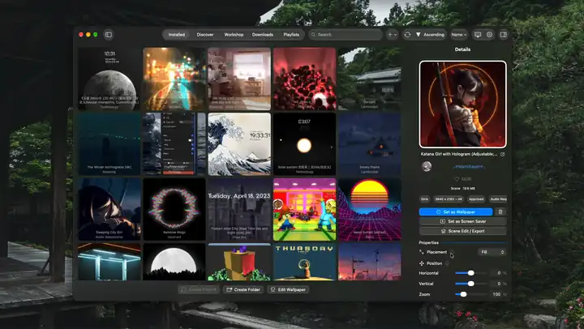</a>

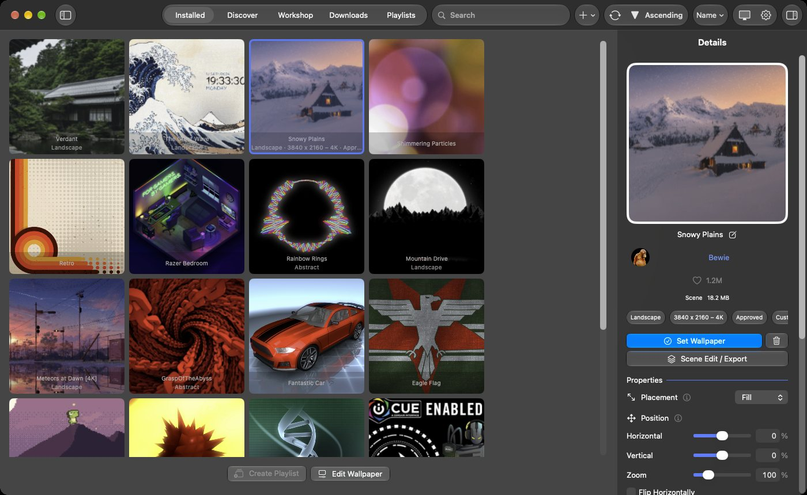

## Onu Farklı Kılanlar

- **Wallpaper Engine sahnelerini düzenleyen tek macOS uygulaması.** Duvar Kâğıdı Düzenleyici bir sahnenin katmanlarını, efektlerini, parçacıklarını, zaman çizelgesini ve betiklerini açar ve sahneyi bir Wallpaper Engine duvar kâğıdı olarak kaydeder.
- **Live Photo ve Wallpaper Engine Android dışa aktarması.** Her sahne veya video, iPhone ve iPad için hareketli bir kilit ekranına ya da Wallpaper Engine’in Android uygulaması için bir pakete dönüşür.
- **Wallpaper Engine’in kendi gölgelendiricileri, çevrilmiş olarak.** Her katman, efekt ve malzeme, duvar kâğıdının Metal’e çevrilmiş özgün gölgelendiricileriyle çizilir; Atölye yazarlarının kendi yazdığı efektler de buna dahildir.
- **Tamamen canlı bir ekran koruyucu.** Ekran koruyucu her ekranın duvar kâğıdını çalıştığı hâliyle çizer; böylece saatler, betikler ve sese duyarlı bölümler hareket etmeye devam eder. Hiçbir şey kaydedilmez.

## Öne Çıkanlar

- **Sahne, video ve web duvar kâğıtları**: efektler, parçacıklar, 3B modeller, ışıklar, zaman çizelgeleri, SceneScript ve sese duyarlı görseller içeren sahneler; ayrıca bunu gösterebilen ekranlarda sahneler ve HDR10 ya da HLG videolar için HDR çıkışı. Web duvar kâğıtları WebKit’te veya isteğe bağlı Chromium motorunda; klasör özellikleri, canlı ses ve Şu An Çalan bilgisiyle çalışır.
- **Steam Atölyesi**: Wallpaper Engine’in sıralamaları ve filtreleriyle göz atın, kendi Steam hesabınızla indirin (Steam mobil uygulamasının QR koduyla ya da parolanızla giriş yapın) ya da duvar kâğıdı klasörlerini ve zip dosyalarını içe aktarın. Yüklü sekmesinde Wallpaper Engine’in klasörleri ve sıralamaları bulunur. SteamCMD ve Steam Web API anahtarı kullanımdan kaldırıldı: 1.0.0-beta.13’ten beri ikisinin yerini Steam mobil uygulamasıyla giriş aldı.
- **Duvar Kâğıdı Düzenleyici**: Wallpaper Engine’in düzenleyicisinin ruhunu taşıyan bir düzenleyici. Katmanları gizmo’larla ekleyip yerleştirin, efektleri önizlemeleriyle ekleyin, kendi efektlerinizi Gölgelendirici Düzenleyici’de yazıp düzenleyin, FBX ve OBJ modelleri içe aktarın, bir zaman çizelgesinde canlandırın, SceneScript yazın, kullanıcı özellikleri oluşturun, parçacık sistemlerini ve Puppet Warp iskeletlerini düzenleyin ve Wallpaper Engine’in görüntü araçlarını kullanın (Ön Plan Ayırma, Karakter Sayfası Oluşturma, Normal Harita Oluşturma). **Yeni Duvar Kâğıdı…** bir resimden ya da Wallpaper Engine’in şablonlarından birinden yeni bir duvar kâğıdı başlatır. Bir taslağı düzenlersiniz: **Kaydet** taslağı uygular, **Yeni Duvar Kâğıdı Olarak Kaydet** kitaplığa bir kopya ekler; duvar kâğıdının kendi dosyaları hiçbir zaman değiştirilmez.

  <!-- demo: wallpaper-editor -->

  <a href="../../docs/media/demo/wallpaper-editor.webm">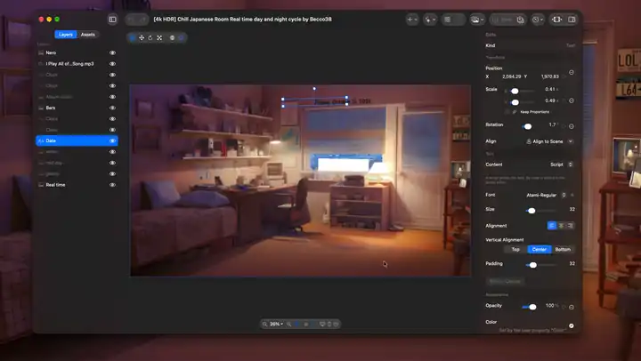</a>

  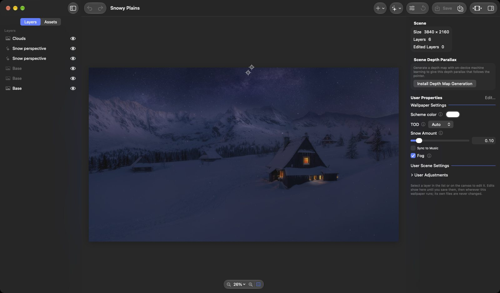

  <!-- demo: model-import -->

  <!-- demo: shader-editor -->

- **Sahne Düzenle/Dışa Aktar**: çalışan duvar kâğıdının katmanlarını ve efektlerini doğrudan masaüstünde canlı olarak değiştirin, ekran koruyucunun ne göstereceğini seçin ya da duvar kâğıdını bir Live Photo veya Android paketi olarak dışa aktarın.

  <a href="../../docs/media/demo/scene-edit.webm">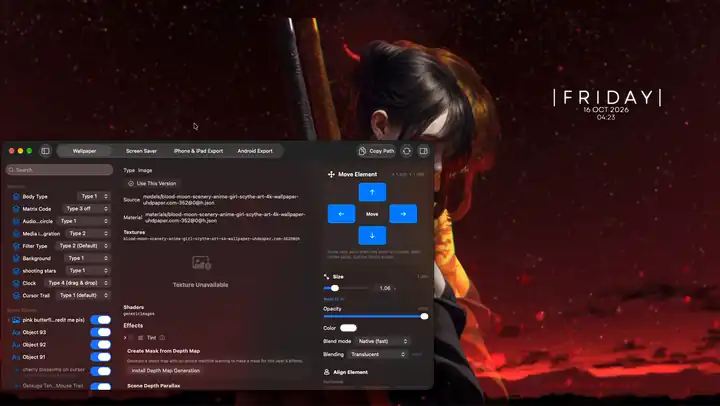</a>

  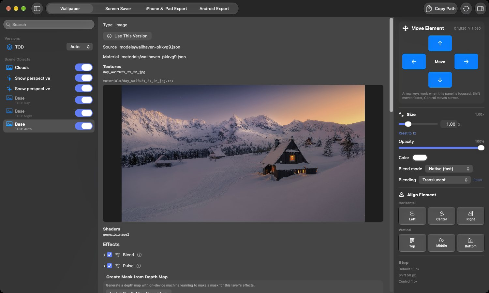

- **Ekran koruyucu ve kilit ekranı**: ekran koruyucu her ekranın duvar kâğıdını canlı olarak (*Ekran Koruyucu Duvar Kâğıdıyla Aynı*) ya da sizin seçtiğiniz bir duvar kâğıdını gösterir; kilit ekranı ise onun bir resmini gösterir.

  <!-- demo: screen-saver -->

- **Dışa aktarma**: iPhone ve iPad için AirDrop ile gönderilen ya da Fotoğraflar’a kaydedilen Live Photo kilit ekranları ve bir QR koduyla Wi-Fi üzerinden aygıta gönderilen Wallpaper Engine Android paketleri.

  <!-- demo: live-photo-export -->

  <a href="../../docs/media/demo/live-photo-export.webm">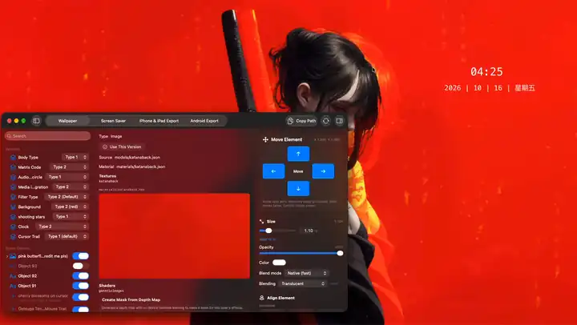</a>

  <!-- demo: android-export -->

  <a href="../../docs/media/demo/android-export.webm">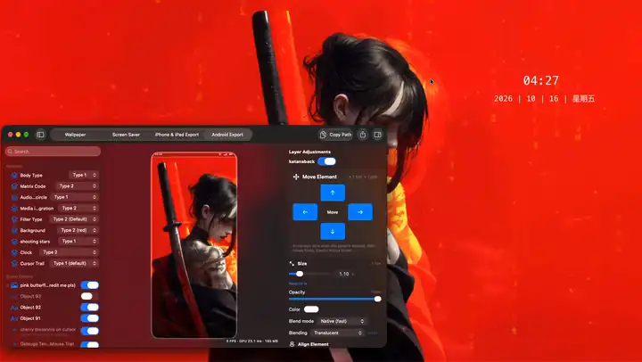</a>

  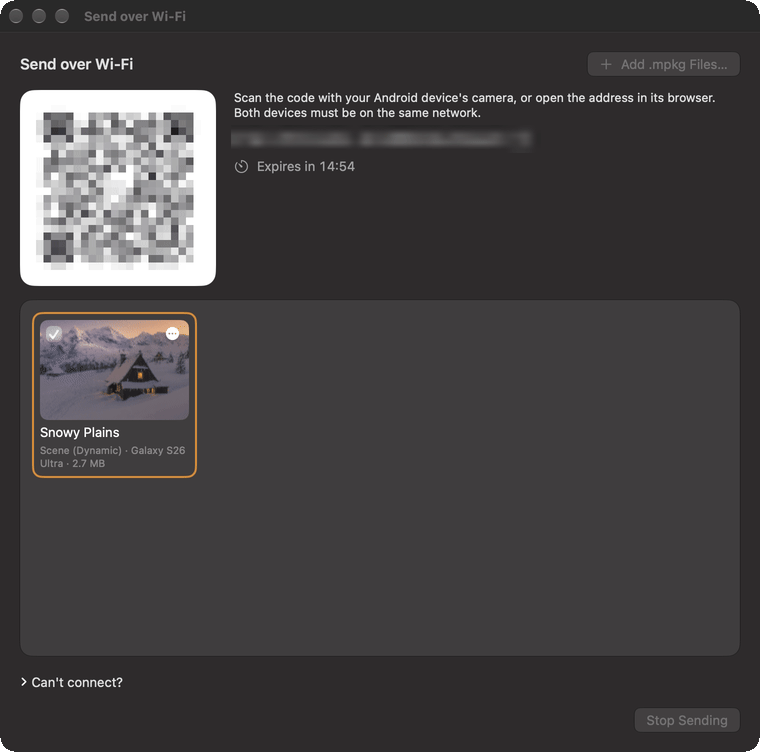

- **Ekranlar**: Wallpaper Engine’deki gibi her ekrana ayrı bir duvar kâğıdı, tüm ekranlara yayılan ya da her birine kopyalanan tek bir duvar kâğıdı; ayrıca gruplar, bölmeler ve profiller. **Pencerede Oynat** bir duvar kâğıdını kendi penceresinde oynatır.

  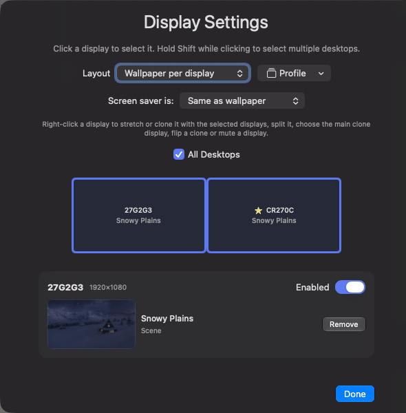

- **Çalma listeleri**: duvar kâğıtlarını zamanlayıcıyla, oturum açılışında, günün saatine veya haftanın gününe göre, Wallpaper Engine’in geçişleriyle değiştirin.

  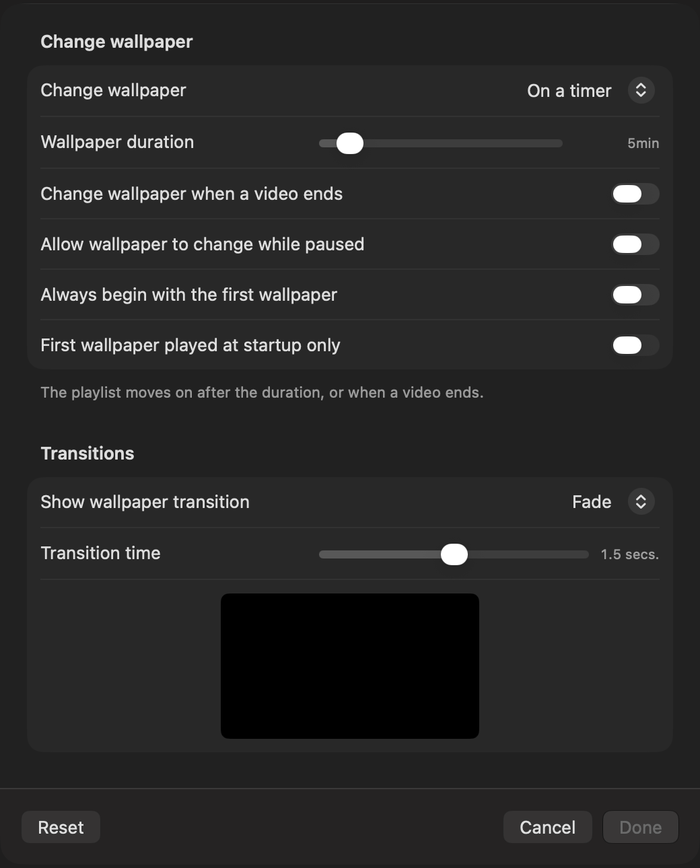

- **Denetim**: eylemler, çalma listeleri, duvar kâğıtları ve ekran profilleri için kısayol tuşları; Wallpaper Engine’in `-control` [komut satırı](../../docs/command-line.md); ve MCP istemcilerinin, yalnızca sizin hesabınızın açabildiği yerel bir bağlantı üzerinden duvar kâğıtlarını, çalma listelerini ve ayarları belirleyip sahneleri düzenlediği **MCP Sunucusu** eklentisi.

  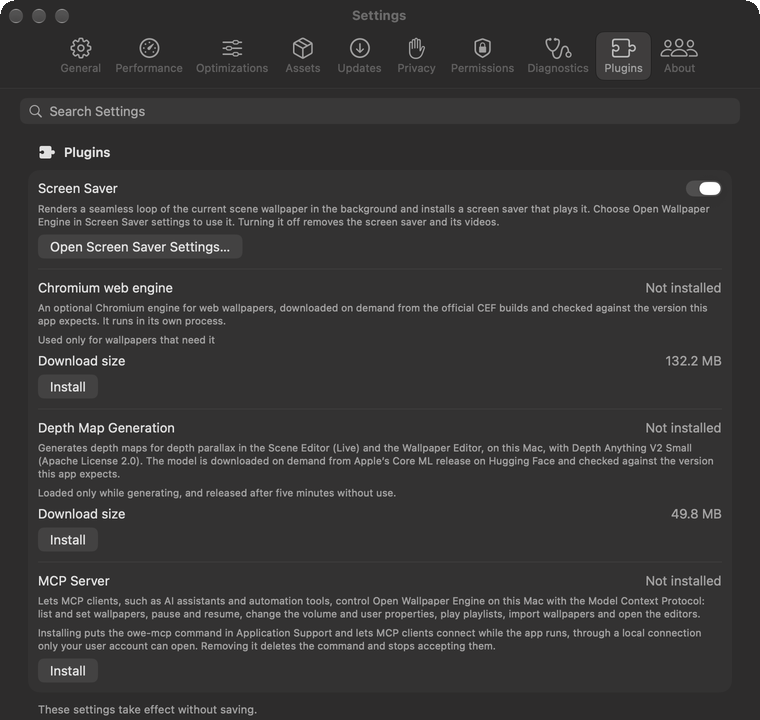

- **Güç**: duvar kâğıtları ekran kilitliyken duraklar, Wallpaper Engine’in *Dizüstü bilgisayar pille çalışırken* kuralına uyar ve pilde ya da Düşük Güç Modu’nda daha düşük bir kalite ön ayarına ve kare hızına geçebilir.
- **Renk Teması**: menü çubuğu, vurgu rengi ve renklendirilmiş simgeler ile klasörler duvar kâğıdının rengine uyar; Open Wallpaper Engine’in kendi pencereleri tam rengi kullanabilir.

  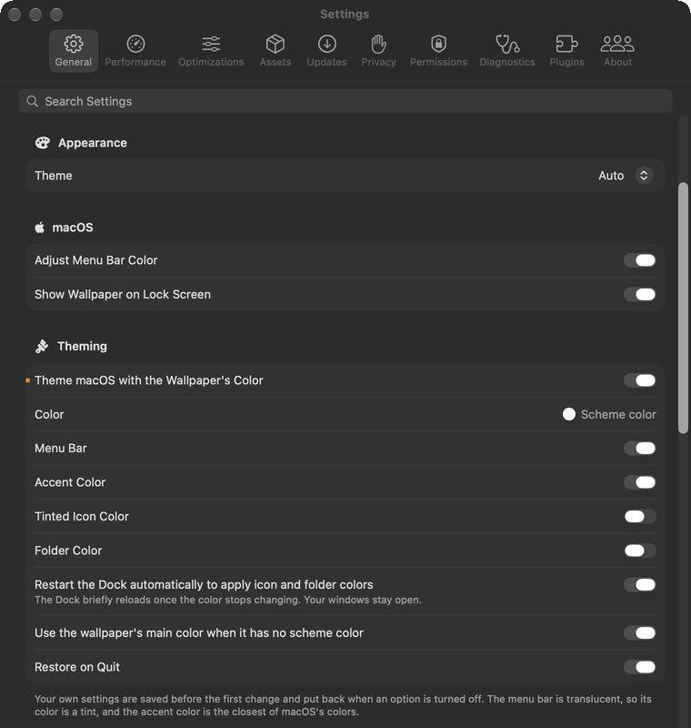

Geri kalan her şey, alan alan: [docs/features.md](../../docs/features.md).

## Yükleme

1. En son sürümü [openwallpaperengine.app](https://openwallpaperengine.app/) adresinden veya [GitHub Releases](https://github.com/deepratna-awale/open-wallpaper-engine-mac/releases) sayfasından indirin. Uygulama imzalı ve noter onaylıdır, kendini kendisi günceller.
2. DMG’yi açın ve **Open Wallpaper Engine**’i Uygulamalar klasörüne sürükleyin.

**macOS 14.0 (Sonoma) veya daha yeni bir sürüm** gerekir. Sahne duvar kâğıtları, Steam’deki kendi Wallpaper Engine kopyanızdan gelen Wallpaper Engine varlıklarını gerektirir; video ve web duvar kâğıtları gerektirmez. Bazı özellikler daha yeni bir macOS, bir izin ya da bir eklenti gerektirir: bkz. [Başlarken](../../docs/getting-started.md#requirements).

## Hızlı Başlangıç

1. Uygulamayı açın. Kurulum yardımcısı dili, Steam oturumunuzu ve Wallpaper Engine varlıklarını ayarlar ve Wallpaper Engine favorilerinizi ve klasörlerinizi içe aktarabilir; her adım atlanabilir.
2. Sahne duvar kâğıtlarını kullanmak istiyorsanız Wallpaper Engine varlıklarını yükleyin (*Ayarlar › Varlıklar*). Bunlar Steam’deki kendi Wallpaper Engine kopyanızdan gelir; video ve web duvar kâğıtları bunlar olmadan da çalışır.
3. **Keşfet** ve **Atölye** sekmelerinde duvar kâğıdı bulun, bir duvar kâğıdı klasörünü veya zip dosyasını içe aktarın (*Dosya › Klasörden Duvar Kâğıdı İçe Aktar…*, ⌘I) ya da **Duvar Kâğıdı Ekle › Yeni Duvar Kâğıdı…** ile bir tane oluşturun.
4. Kitaplıkta bir duvar kâğıdına tıklayın, ardından ayrıntılarında **Duvar Kâğıdı Yap**’a tıklayın (ya da duvar kâğıdına sağ tıklayıp **Duvar Kâğıdı Yap**’ı seçin). Özellikleri hemen altında listelenir.

Daha fazlası: [Başlarken](../../docs/getting-started.md) ve [wiki](https://github.com/deepratna-awale/open-wallpaper-engine-mac/wiki).

## Gizlilik

Uygulamanın kaydettiği her şey Mac’inizde kalır; uygulama hiçbir veri ya analiz toplamaz. Steam (Atölye ve varlıklar için), openwallpaperengine.app (güncellemeleri denetlemek için) ve GitHub (güncellemeleri indirmek için) ile iletişim kurar; eklentiler yalnızca siz yüklediğinizde indirilir. Ayrıntılar: [uygulamanın bağlandığı yerler](../../docs/getting-started.md#what-the-app-connects-to) ve [Gizlilik Politikası](../../docs/legal/privacy-policy.md).

## Belgeler

- [Başlarken](../../docs/getting-started.md) — gereksinimler, varlıklar, Atölye ve içe aktarma
- [Özellikler](../../docs/features.md) — uygulamanın desteklediği her şey ve nasıl kullanılacağı
- Kılavuzlar: [ekran düzenleri](../../docs/display-layouts.md) · [çalma listeleri](../../docs/playlists.md) · [ekran koruyucu](../../docs/screen-saver.md) · [iPhone ve iPad’e dışa aktarma](../../docs/iphone-ipad-export.md) · [Android’e dışa aktarma](../../docs/android-export.md) · [derinlik haritaları](../../docs/depth-maps.md) · [temalar](../../docs/theming.md) · [model içe aktarma](../../docs/model-import.md) · [görüntü araçları](../../docs/image-tools.md) · [MCP Sunucusu](../../docs/mcp.md) · [komut satırı](../../docs/command-line.md) · [Chromium web motoru](../../docs/chromium-engine.md)
- [Geliştirme](../../docs/development.md) — kaynaktan derleme ve proje yapısı; ayrıca [CONTRIBUTING.md](../../CONTRIBUTING.md) ve [mimari](../../docs/architecture.md)
- [Wiki](https://github.com/deepratna-awale/open-wallpaper-engine-mac/wiki) — kılavuzlar, ayar başvurusu ve sorun giderme

## İlgili Projeler

- **[Open Wallpaper Engine for Linux](https://github.com/Unayung/simple-linux-wallpaperengine-gui)** — [linux-wallpaperengine](https://github.com/Almamu/linux-wallpaperengine) için Steam Atölyesi entegrasyonuna sahip, arayüz tasarımı bu macOS sürümünden aktarılmış bir PyQt6 grafik arayüzü.

## Katkıda Bulunanlar

Bu proje aşağıdaki kişilerin çalışmaları üzerine inşa edilmiştir:

- **[MrWindDog](https://github.com/MrWindDog)** — Üst kaynak [wallpaper-engine-mac](https://github.com/MrWindDog) çatalının bakımcısı; yeni özellikler ve arayüz iyileştirmeleri ekledi
- **[Haren Chen](https://github.com/haren724)** — [open-wallpaper-engine-mac](https://github.com/haren724/open-wallpaper-engine-mac)’in asıl yaratıcısı; uygulamanın temel mimarisini oluşturdu (SwiftUI, video duvar kâğıdı oynatma, içe aktarma sistemi, çalma listesi arayüzü)
- **1ris_W** — Çince yerelleştirme çevirisi
- **[Klaus Zhu](https://github.com/klauszhu1105)** — Özgün logo tasarımı
- **[Chen Chia Yang](https://github.com/Unayung)** — Sahne duvar kâğıdı işleme, web duvar kâğıdı düzeltmeleri, Steam Atölyesi entegrasyonu, çoklu ekran desteği, zip içe aktarma
- **[Deepratna Awale](https://github.com/deepratna-awale)** — Metal sahne işleyicisi ve efekt ardışık düzeni, GLSL→MSL gölgelendirici çevirisi ve önbelleğe alma, SceneScript çalışma zamanı, sese duyarlı işleme, Atölye ve İndirilenler bölümlerinin yenilenmesi, yerleşim ve performans ayarları, logo yeniden tasarımı

Orijinal projeyle aynı şekilde [GPL-3.0](../../LICENSE) lisansı altında lisanslanmıştır.

Uygulamanın ayrı bir program olarak çalıştırdığı Steam yardımcısı ([`SteamHelper/`](../../SteamHelper/README.md#license)), [DepotDownloader](https://github.com/SteamRE/DepotDownloader) (GPL-2.0) ve [SteamKit2](https://github.com/SteamRE/SteamKit) (LGPL-2.1) içerdiği için GPL-2.0-or-later lisanslıdır.

## Yasal

[Kullanım Koşulları](../../docs/legal/terms-of-use.md) · [Gizlilik Politikası](../../docs/legal/privacy-policy.md) · [Güvenlik Politikası](../../SECURITY.md)

- **English:** Please read the Terms of Use and the Privacy Policy.
- **Deutsch:** Bitte lesen Sie die Nutzungsbedingungen und die Datenschutzrichtlinie.
- **Français :** Veuillez lire les conditions d’utilisation et la politique de confidentialité.
- **Español:** Lee las condiciones de uso y la política de privacidad.
- **Português (Brasil):** Leia os Termos de Uso e a Política de Privacidade.
- **Italiano:** Leggi le condizioni d’uso e l’informativa sulla privacy.
- **日本語：** 利用規約とプライバシーポリシーをお読みください。
- **한국어:** 이용 약관과 개인정보 처리방침을 읽어 주십시오.
- **简体中文：** 请阅读使用条款和隐私政策。
- **繁體中文：** 請閱讀使用條款和隱私權政策。
- **Русский:** Прочитайте условия использования и политику конфиденциальности.
- **Polski:** Przeczytaj warunki korzystania i politykę prywatności.
- **Türkçe:** Lütfen Kullanım Koşulları’nı ve Gizlilik Politikası’nı okuyun.
- **Українська:** Прочитайте умови використання та політику приватності.
- **العربية:** يُرجى قراءة شروط الاستخدام وسياسة الخصوصية.
- **हिन्दी:** कृपया उपयोग की शर्तें और गोपनीयता नीति पढ़ें।
